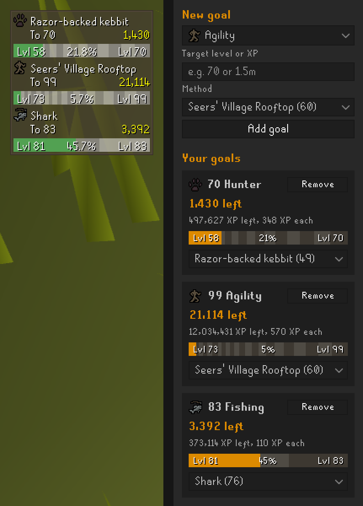

# How Many More

How many more laps to 70 Agility? How many more sharks to 99 Fishing? Set a skill goal and the method you're training
with, and a small box on screen counts down the catches, laps or other actions you have left, with every XP drop.

<p align="center">
  
</p>

## Using it

1. Install **How Many More** from the Plugin Hub.
2. Open the **How Many More** sidebar panel (the flag icon).
3. Pick a skill, type a target level (`70`) or an XP amount (`1,500,000` or `1.5m`), and pick a method.
4. Click **Add goal**. The goal appears on screen and in the sidebar.

You can change a goal's method at any time in its sidebar card. To plan a switch, like Canifis to 60 Agility and then
Seers' Village, click **Add next method** and set the level to switch at. The card shows the actions left with each
method, the on-screen box shows the current method's count as well as the goal's, and a chat message tells you when to
switch. Goals are saved for each account.

The progress bars shade every other level still to come, so you can see the level-ups ahead.

## Methods

The methods and their XP come from RuneLite's built-in Skill Calculator, so they cover every skill it covers and stay
current with RuneLite updates. Rooftop courses count full laps. Where the calculator has XP bonuses, like the gilded
altar for bones or a skilling outfit, you can pick one.

Two choices work for any skill, including the combat skills and Slayer, which the calculator doesn't cover:

- **Custom XP each**: type the XP you get each time.
- **Auto**: uses the size of your last XP drop in that skill. This doesn't suit agility courses, where each obstacle
  gives its own drop.

## Settings

- **Show HUD**, **Show progress bar** and **Show XP left**: what the on-screen box shows.
- **Show finish time**: the time of day you'll reach a goal at your recent XP/hr, when that's within a day.
- **Count down**: *Actions* counts the actions left. *Time* shows the time left at your XP/hr over your last 30
  minutes of training in that skill, not counting breaks over 5 minutes. It shows the actions left until you've
  trained for 2 minutes.
- **Hide when not training**: hides a goal after this many minutes without XP in its skill. 0 always shows it.
- **Goal reached notification**: a notification and chat message when you reach a goal.
- **Goal reached summary**: adds the XP gained, training time and XP/hr to that chat message.

## Say hi

Made by **Krypt0fy** (that's a zero, not an o). Stuck, or your favourite training method is missing? Add me in game.

In case you're wondering, here's my own goal:

```
Goal:      10,000,000 GP
Method:    Generous strangers
Tips left: 9,999,999
```

Every tip in game knocks a few off the count. No pressure, though. I'll never ask for your password, bank PIN or
items, and I can't double your money. Nobody can.
